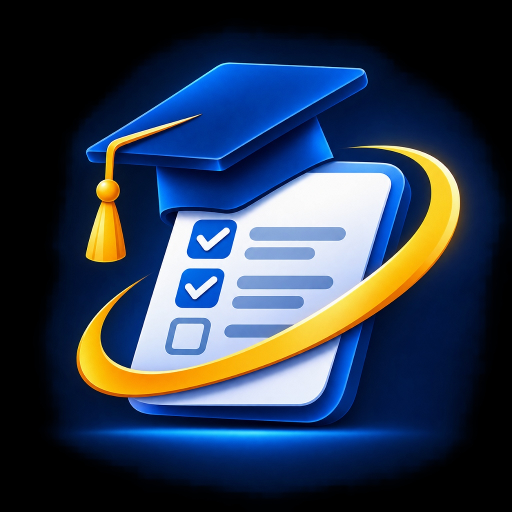

# Microsoft Certification Exam Practice Simulator

A modern, high-performance, interactive 3D web application designed for comprehensive preparation for official Microsoft certification exams. Built with zero external dependencies—completely self-contained and ready to run locally or hosted anywhere.



---

## 🎯 Overview

This simulator provides **250 original scenario-based practice questions** mapped directly to published Microsoft exam skills outlines across 5 core certifications. It combines realistic exam conditions (timed sessions, anti-cheating tab-switch detection, multi-select question formats) with powerful learning tools (step-by-step explanations, weak-spot drill generators, and detailed analytics).

---

## 📚 Included Certifications

| Exam Code | Exam Title | Duration | Questions | Core Domains Covered |
| :--- | :--- | :---: | :---: | :--- |
| **PL-300** | Microsoft Power BI Data Analyst | 100 min | 50 | Prepare the Data, Model the Data, Visualize & Analyze, Manage & Secure |
| **PL-900** | Microsoft Power Platform Fundamentals | 45 min | 50 | Business Value, Foundational Components, Power Apps & Power BI, Power Automate & Copilot Studio |
| **DP-600** | Microsoft Fabric Analytics Engineer | 100 min | 50 | Plan/Manage Solutions, Prepare/Serve Data, Semantic Models, Explore & Analyze Data |
| **DP-700** | Microsoft Fabric Data Engineer | 100 min | 50 | Solution Architecture, Ingest & Transform Data, Monitor & Optimize |
| **DP-800** | Developing AI-Enabled Database Solutions | 100 min | 50 | Design & Develop Database Solutions, Secure/Optimize/Deploy, AI Capabilities in SQL |

---

## ✨ Key Features

### 🎮 3D Tactile Design & Interactive Animations
* **Interactive 3D Perspective Background (`#bg3d`)**: HTML5 Canvas engine rendering a dynamic perspective floor grid and drifting geometric polyhedra that cruise forward in 3D space as you scroll.
* **Mechanical Tactile Keycaps (`.cell`)**: The question palette features elevated 3D keycaps with physical press-down depression (`translateY(2px)`), stamped status when answered, and flag ribbons.
* **Gyroscope-Style Card Tilt**: Mouse movement dynamically tilts panels, cards, and option slabs in 3D space (`perspective(1000px) rotateX(...) rotateY(...)`) with subtle specular lighting reflections.
* **Randomized Click Particle Bursts**: Every click triggers one of 5 distinct visual particle effects (Shockwaves, Star Sparks, Concentric Ripples, Floating Orbs, or 3D Diamond Shards).
* **Randomized Question Transitions**: Navigating questions cycles through 4 distinct 3D transitions (Perspective Flip, Isometric Glide, Depth Zoom, and Elastic Drop-In).
* **Celebratory 3D Confetti**: A physics-based 3D confetti burst celebrating passing scores ($\ge 70\%$).
* **Liquid Shimmer Progress Bar**: An animated fluid beam running through the progress indicator.
* **Top Scroll Progress Tracker**: Pinned top indicator tracking exact scroll depth.

### 🧠 Realistic Exam Simulation & Learning Modes
* **Full Randomization Engine**: Shuffles question sequences and option ordering (`A`–`D`) on every attempt using the Fisher–Yates algorithm.
* **Multi-Select Question Support**: Automatically detects questions requiring multiple answers (*"Choose two"*), scoring only when all correct options are selected.
* **Two Operating Modes**:
  * **Exam Mode**: Standard practice with score and explanations withheld until submission. Optional timer auto-submits at zero.
  * **Learning Mode**: Immediate answer checking with instant visual cues and comprehensive explanations.
* **50/50 Elimination Hints**: Identifies the relevant domain and rules out 1–2 incorrect distractors.

### 🛡️ Proctored Tab-Switch Guard
* Detects window blur and tab switching during an exam.
* Records departure duration and prompts for an explanation in an alert modal.
* **3-Strike Rule**: Automatically concludes and submits the exam on the 3rd exit, logging all switch events and reasons in the final review.

### 📊 Performance Analytics & Tools
* **Score Counter Animation**: Dynamic count-up animation to final score.
* **Domain Breakdown vs. Passing Benchmark**: Visual progress bars marking the 70% threshold (700/1000 equivalent).
* **Time-Per-Question Tracking**: Identifies your pacing and highlights the slowest questions.
* **Weak-Spot Retesting**: Generates a custom targeted test containing only the questions missed in the previous attempt.
* **State Persistence (`localStorage`)**: Automatic test saving, pause/resume capability, safe discard confirmation, and historical score tracking.
* **One-Click Exports**: Download results as a clean `.csv` file or print formatted exam reports.

---

## ⌨️ Keyboard Shortcuts

During an exam session:

| Key | Action |
| :--- | :--- |
| `A`, `B`, `C`, `D` or `1`, `2`, `3`, `4` | Select answer options |
| `→` (Right Arrow) | Navigate to next question |
| `←` (Left Arrow) | Navigate to previous question |
| `F` | Toggle "Flag for review" marker |

---

## 🌓 Display Preferences

A floating glassmorphic 3D dock positioned in the top-right corner allows quick adjustment at any time:
* **Dark / Light Mode**:
  * **Light Mode**: Calm, glare-free architectural slate-grey canvas (`#E1E5EA`) with soft neutral panels.
  * **Dark Mode**: High-contrast, tuned charcoal palette (`#10151C`) with luminous text and exam accents (`#F0F4F8`).
* **Text Sizing**: Cycles through 3 responsive typography scales: `100%`, `115%`, and `130%`.

---

## 🚀 Getting Started

No installation, build tools, or web server required!

1. Clone or download this repository.
2. Ensure `logo.jpg` and `index.html` are in the same folder.
3. Double-click **`index.html`** to open it in any modern browser (Chrome, Edge, Firefox, Safari).

---

## 📁 File Structure

```text
Exam Practice/
├── index.html        # Complete self-contained web app (HTML, CSS, JS, question banks)
├── logo.jpg          # 3D illustration asset (graduation cap, clipboard, golden orbital ring)
└── README.md         # Documentation & guide
```

---

## 📄 License

This practice simulator is intended for personal study, certification preparation, and educational purposes. Practice questions are original works created from official published Microsoft skills outlines and are not copied from live exam items.
