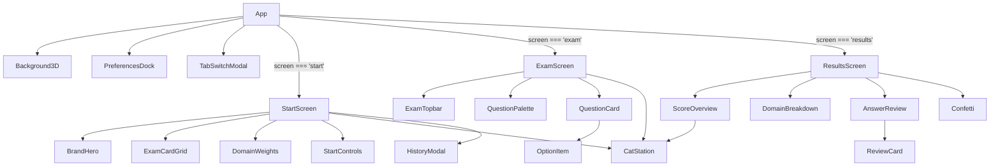

# React.js Architecture & Migration Plan

This plan documents the transformation of the Microsoft Certification Exam Practice Simulator from a single monolithic HTML file into a modular, production-ready **pure React.js** application.

---

## 1. Architectural Overview & Design Principles

* **Pure React.js**: Standard React component hierarchy and unidirectional data flow (no Next.js, no SSR, no backend server dependencies).
* **Zero-Runtime Dependency Option**: Structured as a standard modern React project (`package.json`, Vite configuration, `src/`), while also supporting native browser ES-Module execution so it functions smoothly even on environments without local `node.exe`.
* **State Management**: Custom React hooks (`useExamSession`, `useAntiCheat`, `useCatCompanion`, `useThemePreferences`) encapsulating complex simulation behaviors, timer logic, localStorage persistence, and event listeners.
* **Separation of Concerns**: 
  - All 250 questions divided into distinct exam modules under `src/data/exams/`.
  - UI split into focused, reusable components under `src/components/`.
  - Utility and storage operations abstracted under `src/utils/`.

---

## 2. Directory & File Organization

```
Exam Practice/
├── index.html                   # HTML entry point supporting modern React mounting
├── package.json                 # Pure React.js project manifest and build scripts
├── vite.config.js               # Vite bundler configuration
├── README.md                    # Project documentation, architecture & run guide
├── public/
│   └── logo.jpg                 # Custom 3D graduation cap logo asset
└── src/
    ├── main.jsx                 # React root mounting
    ├── App.jsx                  # Main screen orchestrator & global providers
    ├── index.css                # Matte design tokens, animations & 3D styling
    │
    ├── data/
    │   ├── constants.js         # Limits (MAX_PAUSES=2), storage keys, domain colors
    │   └── exams/
    │       ├── pl300.js         # PL-300: Power BI Data Analyst (50 Qs, 4 domains)
    │       ├── pl900.js         # PL-900: Power Platform Fundamentals (50 Qs, 6 domains)
    │       ├── dp600.js         # DP-600: Fabric Analytics Engineer (50 Qs, 4 domains)
    │       ├── dp700.js         # DP-700: Fabric Data Engineering (50 Qs, 4 domains)
    │       ├── dp800.js         # DP-800: Azure Database Administrator (50 Qs, 4 domains)
    │       └── index.js         # Unified exam registry and helper accessors
    │
    ├── hooks/
    │   ├── useExamSession.js    # Questions, answers, flags, timer, pause limit (max 2)
    │   ├── useAntiCheat.js      # Tab-switch guard, copy/paste/cut/contextmenu blocking
    │   ├── useCatCompanion.js   # Cat mood states, speech bubbles, interactive feedback
    │   └── useThemePreferences.js # Dark/light theme, font size scaling, localStorage sync
    │
    ├── components/
    │   ├── common/
    │   │   ├── Background3D.jsx # Canvas perspective cruising depth grid & 3D shapes
    │   │   ├── PreferencesDock.jsx # Fixed bottom-left 3D theme & text size dock
    │   │   ├── TabSwitchModal.jsx  # Proctored strike warning & justification modal
    │   │   └── Confetti.jsx     # Canvas confetti celebration for test completion
    │   │
    │   ├── companion/
    │   │   ├── CatCompanion.jsx # SVG study buddy cat (tail, eyes, ears, rosy cheeks)
    │   │   └── CatStation.jsx   # Dedicated 3D Study Station card (online badge, perch mat)
    │   │
    │   ├── start/
    │   │   ├── BrandHero.jsx    # Logo, title "Microsoft exam practice", badge
    │   │   ├── ExamCardGrid.jsx # Interactive 3D exam selector cards
    │   │   ├── DomainWeights.jsx # Skill area bar distribution and percentage keys
    │   │   ├── StartControls.jsx # Timed / Learning toggles, Start / Resume buttons
    │   │   └── HistoryModal.jsx # Test score log, dates, and domain breakdowns
    │   │
    │   ├── exam/
    │   │   ├── ExamTopbar.jsx   # Sticky HUD (answered counter, timer, Pause (2 left), Submit)
    │   │   ├── QuestionPalette.jsx # Question navigation grid (1 to 50) and status keys
    │   │   ├── QuestionCard.jsx # Active question card, code snippet, hint, navigation
    │   │   └── OptionItem.jsx   # Upper-alpha option badge with selection pulse
    │   │
    │   └── results/
    │       ├── ScoreOverview.jsx # Passing score badge (70% target), circular progress, restart
    │       ├── DomainBreakdown.jsx # Results by skill area with 70% benchmark indicators
    │       ├── AnswerReview.jsx  # Filterable review list (all, correct, incorrect, flagged)
    │       └── ReviewCard.jsx    # Individual question review card with explanations
    │
    └── utils/
        ├── storage.js           # LocalStorage wrapper with safe JSON serialization
        ├── formatters.js        # Time formatters (mm:ss), percentage calculators
        └── exportCsv.js         # CSV export generator for offline score diagnostics
```

---

## 3. Component Hierarchy



---

## 4. Key Implementation Highlights

1. **State Preservation & Anti-Cheating**:
   - The pause limit (maximum 2 pauses per attempt) is strictly enforced in `useExamSession`.
   - Copying, cutting, pasting, and right-clicking are intercepted in `useAntiCheat` with cheerful cat alerts.
   - Text selection is disabled on question cards via CSS.
2. **Cat Companion Reactions**:
   - The cat sits inside its dedicated 3D Study Station card on the right side of the question card.
   - Contextual comments trigger on pets, answer selection milestones (25%, 50%, 75%, 100%), and flagging.
3. **Palette & Visual Polish**:
   - High-contrast royal blue for answered questions in light mode; luminous blue in dark mode.
   - Smooth results page scroll without disorienting tilt.

Platform                Certification

Databricks              Databricks Certified Data Engineer Associate

Snowflake               SnowPro Core Certification

Azure Databricks        Microsoft Certified: Azure Databricks Data Engineer Associate (DP-750)
 
Databricks              Databricks Certified Data Analyst Associate

Azure AI                Microsoft Certified: Azure AI Apps and Agents Developer Associate (AI-103)

Microsoft Copilot       Microsoft Certified: AI Agent Builder Associate (AB-620)

Anthropic Claude        Claude Certified Developer – Foundations (CCDV-F)

Already added from this list:

Microsoft Fabric        Microsoft Certified: Fabric Data Engineer Associate (DP-700)

Microsoft Fabric        Microsoft Certified: Fabric Analytics Engineer Associate (DP-600)

Power BI	        Microsoft Certified: Power BI Data Analyst Associate (PL-300)
